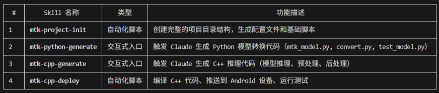
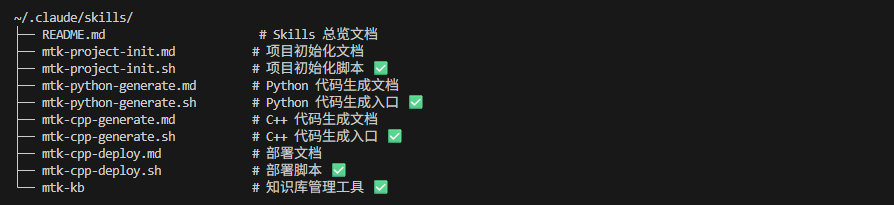

# 待做清单

## 1.14

- [x] ASR 输出没有标点符号的问题
- [ ] 修复长音频输出异常的问题（超过 10s）
- [x] 集成到 sherpa-onnx 项目架构，并测试通过
- [x] 语种自动检测（中英日韩粤）
- [x] MTK dla 模型无法用内存缓存加载的问题
- [x] 修复 MTK 运行时硬编码到设备查找的问题（改为手动指定目录，不依赖设备路径和库文件）

## 1.15

- [x] 熟悉移植标准 Transform 架构算法到 MTK NPU
- [x] 移植带 KV Cache 的 Helsinki 算法到 MTK NPU

## 1.19 - 1.23

- [x] 建立完整的 MTK NPU Skills 工具链（创建 4 个核心 skills，实现从项目初始化到部署测试的完整自动化流程）
- [x] 创建知识库系统（建立中央知识库，记录已知问题、解决方案和最佳实践）
- [x] 整理 MDLA 5.3 算子支持列表（65 个支持算子 + 22 个不支持算子）

**创建的 Skills：**



**创建的文件清单（Skills 相关）：**



**知识库和配置文件：**

```
~/
├── .mtk_npu_config.json          # 统一配置文件（NDK/SDK/平台信息）
├── .mtk_npu_knowledge_base.md    # 中央知识库（已知问题和最佳实践）
└── .mtk_mdla_operators.md        # MDLA 5.3 算子支持列表
```

## 1.29

- [x] EDSR MTK/RK3576 移植部署测试
- [x] RCAN MTK/RK3576 移植部署测试
- [x] Real-ESRGAN MTK/RK3576 移植部署测试
- [x] 协助开发解决翻译模型无法正常工作的问题
- [x] 整理超分辨率项目，提交到远程仓库
