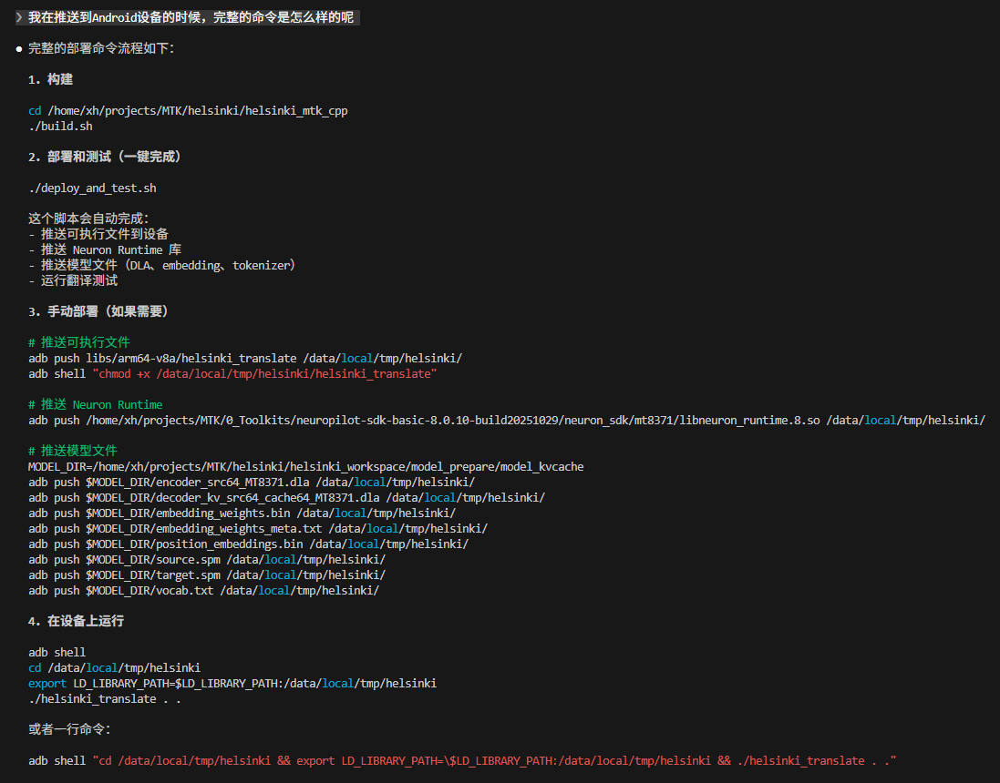
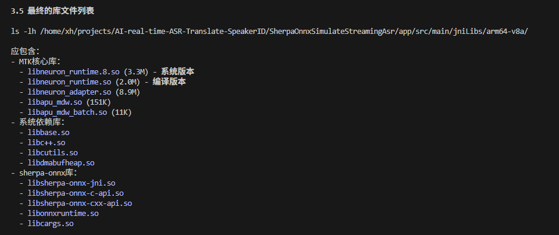

# AI 算法移植到 MTK NPU 完整流程

> 提示词模板 + Skills 设计，以 SenseVoice 为案例

---

## SenseVoice 移植到 MTK NPU

### 1. 上下文

**目标**：把 SenseVoiceSmall 模型跑在 MTK MT8371 芯片的 NPU 上，实现端到端的语音输入、文本输出。

**历史与计划**：分两个大步骤。

**第一步（Python 端）：将模型编译转换为 MTK NPU 支持的 .dla 格式（已完成）**

工作目录：`SenseVoice_workspace/model_prepare`，依次运行 `0_run.sh`、`1_save_pt.sh`、`2_pt2tflite.sh`

1. 将 SenseVoiceSmall 从 PyTorch 格式导出为 `.pt` 格式（关键步骤，需要自定义模型结构适配芯片算子，`torch_model.py` 即自定义结构；导出后需与原始 PyTorch 逐层对比输出是否一致）
2. 再转换为 `.tflite` 格式（需使用 MTK 自定义工具，标准 TF 工具会报错）
3. 验证 `.pt`、`.tflite` 格式模型输出正确且一致（`test_converted_models`）
4. 通过编译脚本 `compile/compile_sensevoice_fp.sh` 将 `.tflite` 转化为 MTK NPU 支持的 `.dla` 格式

**第二步（C++ 端）：编写 C++ 推理代码，编译成可执行文件推送到 Android 设备完成测试（已完成）**

工作目录：`sensevoice_mtk_cpp`

1. 参考 `/home/xh/projects/sherpa-onnx/sherpa-onnx/csrc/rknn/` 下的 `offline-sense-voice-model-rknn.cc` 和 `.h`（已验证的推理过程，适配 RKNN 芯片）
2. 参考 `/home/xh/projects/MTK/GAI-Deployment-Toolkit-v2.0.2_clip-text-v0.1/inference/jni/src` 中正确的 MTK NPU 接口调用，替换掉（1）中错误的接口
3. 编译参考 `/home/xh/projects/MTK/GAI-Deployment-Toolkit-v2.0.2_clip-text-v0.1/inference`，含对应的 shell 脚本、编译流程及第三方库

**目前的环境**：conda 环境 `MTK-sensevoice`

| 资源 | 路径 |
|------|------|
| MTK SDK | `/home/xh/projects/MTK/0_Toolkits/neuropilot-sdk-basic-8.0.10-build20251029/neuron_sdk` |
| NDK | `/home/xh/Android/Ndk/android-ndk-r25c` |
| SDK | `/home/xh/Android/Sdk` |
| OnnxRuntime | `/home/xh/Android/OnnxRuntime/onnxruntime-android-1.17.1` |
| C++ 推理代码 | `/home/xh/projects/sherpa-onnx/sherpa-onnx/csrc/rknn/` |
| MTK 调用接口 | `/home/xh/projects/MTK/GAI-Deployment-Toolkit-v2.0.2_clip-text-v0.1/inference/jni/src` |
| 第三方库 | `/home/xh/projects/MTK/1_third_party/kaldi_native_fbank`（sensevoice 音频处理）|

### 2. 当前意图/任务

1. 在 GitHub 建公开仓库 `MTK-sense-voice`，推送 `/home/xh/projects/MTK/sense-voice` 代码（只推代码，大文件留本地）
2. 在 `GAI-Deployment-Toolkit-v2.0.2_clip-text-v0` 项目中测试 `sensevoice_MT8371.dla` 能否正常加载
3. 复现第一步流程，将模型编译转换为 `.dla` 格式
4. 完成整个测试并推送到 Android 设备，观察输出，有问题分析解决
5. 完全参照 `GAI-Deployment-Toolkit-v2.0.2_clip-text-v0.1` 项目形式操作（已验证可在 Android 设备上运行）

### 3. 约束

（待补充）

### 4. 辅助视觉

（待补充）

---

## SenseVoice 集成到 sherpa-onnx 框架

### 1. 上下文

**目标**：SenseVoice 已验证可在 MTK NPU 上运行，现需把 `sensevoice_mtk_cpp` 的 C++ 代码集成到 sherpa-onnx 框架（`/home/xh/projects/sherpa-onnx`）。

**历史与计划**：

1. 在 `/home/xh/projects/sherpa-onnx/sherpa-onnx/csrc` 新建 `mtk` 目录（参照 `rknn`、`qnn` 目录结构；注意 MTK 运行时库文件需要动态加载）
2. 同步修改其他相关位置，使上层 Kotlin 可以正常调用
3. 重新编译整个项目 C++ 代码，参考 `build-android-rknn.sh`，同时加入 MTK 运行所需的包
4. 将 `SherpaOnnxSimulateStreamingAsr` 编译为 APK 并推送到 Android 设备测试
   - `/assets/sense-voice-mtk` 已放入 `sensevoice-10s.dla` 和 `tokens.txt`
   - `OfflineRecognizer.kt` 中已添加以下代码（需确认是否与 C++ 代码适配）：
     ```kotlin
     1000 -> {
         // MTK SenseVoice - 中英日韩粤多语言识别
         return OfflineModelConfig(
             senseVoice = OfflineSenseVoiceModelConfig(
                 model = "modelDir/tokens.txt",
                 provider = "mtk",   // 关键：使用 MTK NPU
                 numThreads = 1,     // MTK NPU 模式下使用 1 线程
             )
         )
     }
     ```
   - 观察日志查看输出

**目前的环境**：conda 环境 `MTK-sensevoice`

| 资源 | 路径 |
|------|------|
| NDK | `/home/xh/Android/Ndk/android-ndk-r25c` |
| SDK | `/home/xh/Android/Sdk` |
| OnnxRuntime | `/home/xh/Android/OnnxRuntime/onnxruntime-android-1.17.1` |
| sensevoice_mtk_cpp | `/home/xh/projects/MTK/sense-voice/sensevoice_mtk_cpp` |
| sherpa-onnx | `/home/xh/projects/sherpa-onnx` |

### 2. 当前意图/任务

目前（1）（2）（3）已完成，当前聚焦第（4）步：

1. 重新编译 `build-android-mtk.sh`，用生成的 `sherpa-onnx-offline` 测试 SenseVoice 在 MTK 平台正常运行
2. 测试通过后，编译 APK 推送到 Android 设备测试

**后续待处理**：

- ① 先继续第（4）步 APK 测试，验证命令行已正常工作，APK 同步处理运行时库文件（参照 rknn 方式统一处理）
- ② 回过头解决 MTK 从内存加载模型（而不是复制 assets 到文件系统再访问）的问题

---

## Helsinki 算法移植到 MTK NPU

### 1. 上下文

**目标**：把当前用 OnnxRuntime 跑在 CPU 上的 Helsinki 翻译算法移植到 MTK NPU，推送到 Android 设备完成推理测试。

**历史与计划**：分两个大步骤。

**第一步（Python 端）**：pytorch → tflite → dla，每个节点完成后测试正确性（dla 除外）

参考 SenseVoice（`SenseVoice_workspace`）、clip-text（`model_prepare`）项目 Python 部分

**第二步（C++ 端）**：将 Python 推理代码转化为 C++，参考 sensevoice 项目的 C++ 部分（`sensevoice_mtk_cpp`），了解 MTK 接口调用方式

**目前的环境**：conda 环境 `MTK-helsinki`，python=3.10，需复制 `MTK-clip-encoder` 环境并安装其他依赖

| 资源 | 路径 |
|------|------|
| MTK SDK | `/home/xh/projects/MTK/0_Toolkits/neuropilot-sdk-basic-8.0.10-build20251029/neuron_sdk` |
| MT8371 库文件 | `/home/xh/projects/MTK/0_Toolkits/.../neuron_sdk/mt8371` |
| Android NDK | `/home/xh/Android/Ndk/android-ndk-r25c` |
| Android SDK | `/home/xh/Android/Sdk` |
| OnnxRuntime | `/home/xh/Android/OnnxRuntime/onnxruntime-android-1.17.1` |
| sensevoice_mtk_cpp | `/home/xh/projects/MTK/sense-voice/sensevoice_mtk_cpp` |
| SenseVoice_workspace | `/home/xh/projects/MTK/sense-voice/SenseVoice_workspace` |
| clip-text | `/home/xh/projects/MTK/GAI-Deployment-Toolkit-v2.0.2_clip-text-v0.1/model_prepare` |
| Helsinki C++ 推理 | `/home/xh/projects/Local-multilingual-real-time-speech-recognition-and-real-time-subtitle-translation/translate/helsinki-onnx` |

### 2. 当前意图/任务

conda 环境已创建，工作目录 `/home/xh/projects/MTK/helsinki`，建立两个子目录 `helsinki_workspace`、`helsinki_mtk_cpp`

当前任务：跑一遍 `helsinki_workspace` 中的代码，测试 `.pt`、`.tflite` 格式导出及正确性验证，通过后编译成 `.dla` 文件

> C++ 推理代码已在 `/home/xh/projects/Local-multilingual-real-time-speech-recognition-and-real-time-subtitle-translation/translate/helsinki-rknn/cpp`，但该版本针对 CPU OnnxRuntime，需改造适配 MTK NPU（MTK NPU 接口调用参考 `sensevoice_mtk_cpp`）

### 3. 约束

（待补充）

### 4. 辅助视觉





---

## facebook/m2m100_418M 算法移植到 MTK NPU

### 1. 上下文

**目标**：把 m2m100_418M 算法移植到 MTK NPU，推送到 Android 设备完成推理测试。

**历史与计划**：分两个大步骤。

**第一步（Python 端）**：pytorch.bin → pt → tflite → dla

- 每个转换节点完成后需单独测试，正确后再进行下一节点（dla 除外）
- 参考 Helsinki（`Helsinki_workspace`）、clip-text（`model_prepare`）项目 Python 部分（同为标准 Transformer encoder-decoder 架构）
- 注意：需导出带 KV Cache 的版本；pt → tflite 会用到 MTK 自定义算子，可能失败需重新调整导出代码
- 问题记录：`MTK/helsinki/PORTING_NOTES.md`

**第二步（C++ 端）**：将 Python 推理代码转化为 C++，参考 Helsinki 项目的 C++ 部分（`Helsinki_mtk_cpp`），了解 MTK 接口调用方式

**目前的环境**：conda 环境 `MTK-m2m100`，python=3.10，需复制 `MTK-clip-helsinki` 环境并安装其他依赖

| 资源 | 路径 |
|------|------|
| MTK SDK | `/home/xh/projects/MTK/0_Toolkits/neuropilot-sdk-basic-8.0.10-build20251029/neuron_sdk` |
| MT8371 库文件 | `/home/xh/projects/MTK/0_Toolkits/.../neuron_sdk/mt8371` |
| Android NDK | `/home/xh/Android/Ndk/android-ndk-r25c` |
| Android SDK | `/home/xh/Android/Sdk` |
| OnnxRuntime | `/home/xh/Android/OnnxRuntime/onnxruntime-android-1.17.1` |
| helsinki_mtk_cpp | `/home/xh/projects/MTK/helsinki/helsinki_mtk_cpp` |
| helsinki_workspace | `/home/xh/projects/MTK/helsinki/helsinki_workspace` |
| sentencePiece | `/home/xh/projects/MTK/1_third_party/sentencepiece` |

### 2. 当前意图/任务

工作目录 `/home/xh/projects/MTK/m2m100`，建立 `m2m100_workspace`、`m2m100_mtk_cpp` 两个子目录

Python 端工作已完成。当前疑问：为什么说"MT8371 MDLA 限制维度 <= 65535，而 M2M100 的 vocab_size=128112，lm_head 层无法在 NPU 上执行"？该结论如何得出，C++ 端需采用不带 lm_head 的版本吗？

下载模型使用 ModelScope，只需 `pytorch.bin` 权重文件：
https://www.modelscope.cn/models/facebook/m2m100_418M/files

### 3. 约束

（待补充）

### 4. 辅助视觉

（待补充）

---

## EDSR、RCAN 移植到 MTK NPU 推理测试

### 1. 上下文

**目标**：将 EDSR、RCAN 移植到 MTK MT8371 芯片的 NPU，推送到 Android 设备完成测试。

**历史与计划**：分三个大步骤。

**第一步（Python 端）**：pytorch.bin/pt → tflite → dla

转换脚本：`step1_pt_to_torchscript.py`、`step2_torchscript_to_tflite.py`、`step3_tflite_to_dla.py`

测试脚本：`test_pytorch.py`、`test_pt.py`、`test_tflite.py`

每个转换节点完成后单独测试，正确后再进行下一节点（dla 除外）；参考 Helsinki 目录格式以及 rk 的 edsr/rcan 项目 Python 代码

**第二步（C++ 端）**：将 Python 推理代码转换为 C++

参考 rk edsr/rcan 项目 C++ 部分，以及 Helsinki 项目了解 MTK API 接口，用正确的 MTK API 接口替换 RKNN 接口

**第三步（Android 端）**：编译 C++ 代码（针对 MT8371 平台），推送到 Android 设备完成推理测试

**目前的环境**：conda 环境 `MTK-superResolution`，python=3.10，需清理后重新 clone `MTK-clip-encoder` 环境

推理测试代码：`MTK/MTKSuperResolution/infer.py`；模型数据及测试图片：`MTK/MTKSuperResolution/data`

| 资源 | 路径 |
|------|------|
| MTK SDK | `/home/xh/projects/MTK/0_Toolkits/neuropilot-sdk-basic-8.0.10-build20251029/neuron_sdk` |
| MT8371 运行时库 | `/home/xh/projects/MTK/0_Toolkits/.../neuron_sdk/mt8371` |
| Android NDK | `/home/xh/Android/Ndk/android-ndk-r18b` |
| Android SDK | `/home/xh/Android/Sdk` |
| OnnxRuntime | `/home/xh/Android/OnnxRuntime/onnxruntime-android-1.17.1` |
| 第三方库/工具 | `/home/xh/projects/MTK/1_third_party`、`/home/xh/projects/MTK/2_utils` |
| MTK DLA 算子列表 | `~/.mtk_mdla_operators.md` |
| 中央知识库 | `~/.mtk_npu_knowledge_base.md` |
| rk edsr 项目 | `/home/xh/projects/rknn_model_zoo/examples/edsr` |
| rk rcan 项目 | `/home/xh/projects/rknn_model_zoo/examples/rcan` |
| Helsinki 项目 | `/home/xh/projects/MTK/helsinki` |

### 2. 当前意图

1. 参考 Helsinki 项目，新建目录结构，检查环境，安装依赖，测试 `.pt` 格式正常推理输出
2. 先完成 EDSR 算法移植，根据计划完成 Python 端工作
3. 有任何缺失文件或需要协助的地方及时沟通

### 3. 注意事项

1. MTK NPU 无法端到端输出，tflite 及 dla 格式只负责推理，前处理和后处理需分离单独处理
2. 如果模型导出失败或报错，可能是算子不支持，需自定义模型结构或修改算子（参考 Helsinki 案例：`/home/xh/projects/MTK/helsinki`）
3. MTK NPU 不支持动态形状，转换为 tflite 时需固定输入形状（510 × 339）
4. 转 tflite 格式及推理测试必须使用 MTK 提供的工具（已集成在环境中），不能使用标准 tflite 工具
5. 有可复用的参考代码优先复用，避免重复造轮子

---

## Real-ESRGAN 移植到 MTK NPU 推理测试

### 1. 上下文

**目标**：将 Real-ESRGAN 移植到 MTK MT8371 芯片的 NPU，推送到 Android 设备完成测试。

**历史与计划**：分三个大步骤。

**第一步（Python 端）**：pytorch.bin/pt → tflite → dla

转换脚本：`step1_pt_to_torchscript.py`、`step2_torchscript_to_tflite.py`、`step3_tflite_to_dla.py`

可参考 rk realesrgan 项目（含原始模型架构定义、权重、测试图片及推理代码）

测试脚本：`test_pytorch.py`（可直接复制 rk 项目的）、`test_pt.py`、`test_tflite.py`

参考 edsr 目录格式重组，工作主要在 Python 端

**第二步（C++ 端）**：将 Python 推理代码转换为 C++

参考 rk realesrgan 项目 C++ 部分，以及 edsr 项目了解 MTK API 接口，替换 RKNN API

**第三步（Android 端）**：编译 C++ 代码（针对 MT8371 平台），推送到 Android 设备完成推理测试

**目前的环境**：conda 环境 `MTK-superResolution`，python=3.10

| 资源 | 路径 |
|------|------|
| MTK SDK | `/home/xh/projects/MTK/0_Toolkits/neuropilot-sdk-basic-8.0.10-build20251029/neuron_sdk` |
| MT8371 运行时库 | `/home/xh/projects/MTK/0_Toolkits/.../neuron_sdk/mt8371` |
| Android NDK | `/home/xh/Android/Ndk/android-ndk-r25c` |
| Android SDK | `/home/xh/Android/Sdk` |
| OnnxRuntime | `/home/xh/Android/OnnxRuntime/onnxruntime-android-1.17.1` |
| 第三方库 | `/home/xh/projects/MTK/1_third_party` |
| 第三方工具 | `/home/xh/projects/MTK/2_utils` |
| MTK DLA 算子列表 | `/home/xh/projects/MTK/.claude/doc/mtk_mdla_operators.md` |
| 中央知识库 | `/home/xh/projects/MTK/.claude/doc/mtk_npu_knowledge_base.md` |
| rk realesrgan | `/home/xh/projects/MTK/superResolution/realesrgan/rknn` |

### 2. 当前意图

1. 参考 mtk/edsr 项目，新建目录结构，检查环境，安装依赖
2. 先完成 Python 端工作，有问题分析解决
3. Python 端完成后逐一检查输出，没有问题后再给出下一步任务

### 3. 注意事项

1. MTK NPU 无法端到端输出，tflite 及 dla 格式只负责推理，前处理和后处理需分离单独处理
2. 如果模型导出失败或报错，可能是算子不支持，需自定义模型结构或修改算子（参考 Helsinki 案例）
3. MTK NPU 不支持动态形状，转换为 tflite 时需固定输入形状（510 × 339）
4. 有可复用的参考代码优先复用
5. 转 tflite 格式及推理测试必须使用 MTK 提供的工具
6. Real-ESRGAN 基于 RRDB（纯 CNN 架构），主要算子（Conv2d、LeakyReLU、Add）MTK 支持良好；需注意 PixelShuffle（上采样）和 LeakyReLU（激活函数），导出 tflite 前需确认
7. 前处理：归一化到 [0,1]；后处理：clip 到 [0,1] 后 ×255 转回 uint8，均需在模型外部单独实现

---

## Whisper 移植到 MTK NPU 推理测试

> 查看 `MTK_models_zoo/.claude/subagents/README.md` 根据 README.md 完成任务

### 1. 上下文

**目标**：将 Whisper 移植到 MTK MT8371 芯片的 NPU，推送到 Android 设备完成测试。

**历史与计划**：分三个大步骤。

**第一步（Python 端）**：pytorch.bin/pt → tflite → dla

转换脚本：`step1_pt_to_torchscript.py`、`step2_torchscript_to_tflite.py`、`step3_tflite_to_dla.py`

- clone openai/whisper 官方仓库，下载 base 模型
- 测试脚本：`test_pytorch.py`（参考 whisper 官方推理脚本）、`test_pt.py`、`test_tflite.py`
- 参考 edsr/mtk 目录格式重组

**第二步（C++ 端）**：将 Python 推理代码转换为 C++

参考 rk whisper 项目 C++ 部分及第三方库，严格复刻 Python 端行为（`test_torchscript.pt`），使用正确的 MTK API 替换 RKNN API

**第三步（Android 端）**：编译 C++ 代码（针对 MT8371 平台），推送到 Android 设备完成推理测试

**目前的环境**：conda 环境 `MTK-whisper`，python=3.10，需 clone `MTK-clip-encoder` 环境并安装依赖

| 资源 | 路径 |
|------|------|
| MTK SDK | `/home/xh/projects/MTK/0_Toolkits/neuropilot-sdk-basic-8.0.10-build20251029/neuron_sdk` |
| MT8371 运行时库 | `/home/xh/projects/MTK/0_Toolkits/.../neuron_sdk/mt8371` |
| Android NDK | `/home/xh/Android/Ndk/android-ndk-r25c` |
| Android SDK | `/home/xh/Android/Sdk` |
| OnnxRuntime | `/home/xh/Android/OnnxRuntime/onnxruntime-android-1.17.1` |
| 第三方库 | `/home/xh/projects/MTK/1_third_party` |
| 第三方工具 | `/home/xh/projects/MTK/2_utils` |
| MTK DLA 算子列表 | `/home/xh/projects/MTK/.claude/doc/mtk_mdla_operators.md` |
| 中央知识库 | `/home/xh/projects/MTK/.claude/doc/mtk_npu_knowledge_base.md` |
| rk whisper 项目 | `/home/xh/projects/rknn_model_zoo/examples/whisper` |

### 2. 当前意图

1. 参考 mtk/edsr 项目，新建目录结构，检查环境，安装依赖
2. 先完成 Python 端工作（带 KV Cache），有问题分析解决
3. Python 端完成后逐一检查输出，没有问题后再给出下一步任务

### 3. 注意事项

1. MTK NPU 无法端到端输出，tflite 及 dla 格式只负责推理，前处理和后处理需分离单独处理
2. 如果模型导出失败或报错，可能是算子不支持，需自定义模型结构或修改算子（参考 Helsinki 案例）
3. MTK NPU 不支持动态形状，转换为 tflite 时需固定输入形状（30s）
4. 有可复用的参考代码优先复用
5. 转 tflite 格式及推理测试必须使用 MTK 提供的工具

---

## SwinIR 移植到 MTK NPU 推理测试

> 查看 `MTK_models_zoo/.claude/subagents/README.md` 根据 README.md 完成任务

### 1. 上下文

**目标**：将 SwinIR 移植到 MTK MT8371 芯片的 NPU，推送到 Android 设备完成测试。

**历史与计划**：分三个大步骤。

**第一步（Python 端）**：pytorch.bin/pt → tflite → dla

转换脚本：`step1_pt_to_torchscript.py`、`step2_torchscript_to_tflite.py`、`step3_tflite_to_dla.py`

- clone SwinIR 官方仓库，下载所需模型
- 测试脚本：`test_pytorch.py`（参考 SwinIR 官方推理脚本）、`test_pt.py`、`test_tflite.py`
- 参考 edsr/mtk 目录格式重组

**第二步（C++ 端）**：将 Python 推理代码转换为 C++

参考 edsr 项目 C++ 部分及第三方库，严格复刻 Python 端行为（`test_pt.py`），使用正确的 MTK API

**第三步（Android 端）**：编译 C++ 代码（针对 MT8371 平台），推送到 Android 设备完成推理测试

**目前的环境**：conda 环境 `MTK-superResolution`，python=3.10

| 资源 | 路径 |
|------|------|
| MTK SDK | `/home/xh/projects/MTK/0_Toolkits/neuropilot-sdk-basic-8.0.10-build20251029/neuron_sdk` |
| MT8371 运行时库 | `/home/xh/projects/MTK/0_Toolkits/.../neuron_sdk/mt8371` |
| Android NDK | `/home/xh/Android/Ndk/android-ndk-r25c` |
| Android SDK | `/home/xh/Android/Sdk` |
| OnnxRuntime | `/home/xh/Android/OnnxRuntime/onnxruntime-android-1.17.1` |
| 第三方库 | `/home/xh/projects/MTK/1_third_party` |
| 第三方工具 | `/home/xh/projects/MTK/2_utils` |
| MTK DLA 算子列表 | `/home/xh/projects/MTK/.claude/doc/mtk_mdla_operators.md` |
| 中央知识库 | `/home/xh/projects/MTK/.claude/doc/mtk_npu_knowledge_base.md` |
| edsr 项目 | `/home/xh/projects/MTK_models_zoo/superResolution/edsr` |

### 2. 当前意图

1. 参考 mtk/edsr 项目，在 `/home/xh/projects/MTK_models_zoo/superResolution` 下新建目录结构，检查环境，安装依赖
2. 先完成 Python 端工作，有问题分析解决
3. Python 端完成后逐一检查输出，没有问题后再给出下一步任务

### 3. 注意事项

1. MTK NPU 无法端到端输出，tflite 及 dla 格式只负责推理，前处理和后处理需分离单独处理
2. 如果模型导出失败或报错，可能是算子不支持，需自定义模型结构或修改算子（参考 Helsinki 案例）
3. MTK NPU 不支持动态形状，转换为 tflite 时需固定输入形状，建议使用 (1, 3, 512, 512)
4. 有可复用的参考代码优先复用
5. 转 tflite 格式及推理测试必须使用 MTK 提供的工具

---

## Zipformer 移植到 MTK NPU 推理测试

> 查看 `MTK_models_zoo/.claude/subagents/README.md` 根据 README.md 完成任务

### 1. 上下文

**目标**：流式 zipformer-zh-en 移植到 MTK MT8371 芯片的 NPU，推送到 Android 设备完成测试。

**历史与计划**：分三个大步骤。

**第一步（Python 端）**：pytorch.bin/pt → tflite → dla

转换脚本：`step1_pt_to_torchscript.py`、`step2_torchscript_to_tflite.py`、`step3_tflite_to_dla.py`

- clone zipformer 中英双语官方仓库，下载对应模型
- 测试脚本：`test_pytorch.py`（参考 zipformer 官方推理脚本）、`test_pt.py`、`test_tflite.py`
- 最终对比 `.pt` 和 `.tflite` 格式输出，验证正确性后再进行下一节点（dla 除外）

**第二步（C++ 端）**：将 Python 推理代码转换为 C++

参考 rk zipformer 项目 C++ 部分及第三方库，严格复刻 Python 端行为（`test_torchscript.pt`），使用正确的 MTK API 替换 RKNN API

**第三步（Android 端）**：编译 C++ 代码（针对 MT8371 平台），推送到 Android 设备完成推理测试

**目前的环境**：conda 环境 `MTK-zipformer`，python=3.10

| 资源 | 路径 |
|------|------|
| MTK SDK | `/home/xh/projects/MTK/0_Toolkits/neuropilot-sdk-basic-8.0.10-build20251029/neuron_sdk` |
| MT8371 运行时库 | `/home/xh/projects/MTK/0_Toolkits/.../neuron_sdk/mt8371` |
| Android NDK | `/home/xh/Android/Ndk/android-ndk-r25c` |
| Android SDK | `/home/xh/Android/Sdk` |
| OnnxRuntime | `/home/xh/Android/OnnxRuntime/onnxruntime-android-1.17.1` |
| 第三方库 | `/home/xh/projects/MTK/1_third_party` |
| 第三方工具 | `/home/xh/projects/MTK/2_utils` |
| MTK DLA 算子列表 | `/home/xh/projects/MTK/.claude/doc/mtk_mdla_operators.md` |
| 中央知识库 | `/home/xh/projects/MTK/.claude/doc/mtk_npu_knowledge_base.md` |
| rk zipformer 项目 | `/home/xh/projects/MTK_models_zoo/zipformer-rk` |
| zipformer 仓库 | `/home/xh/projects/MTK_models_zoo/zipformer-mtk/icefall`（需确认是否正确）|

### 2. 当前意图

1. Python 环境、官方代码仓库、模型权重已准备好，先完成 Python 端工作，有问题分析解决
2. Python 端完成后逐一检查输出，没有问题后再给出下一步任务
3. C++ 部分已写好，可以直接使用

### 3. 注意事项

1. MTK NPU 无法端到端输出，tflite 及 dla 格式只负责推理，前处理和后处理需分离单独处理
2. 如果模型导出失败或报错，可能是算子不支持，需自定义模型结构或修改算子（参考 Helsinki 案例）
3. MTK NPU 不支持动态形状，转换为 tflite 时需固定输入形状
4. 有可复用的参考代码优先复用
5. 转 tflite 格式及推理测试必须使用 MTK 提供的工具

---

## MoonShine 移植到 MTK NPU 推理测试

> 查看 `MTK_models_zoo/.claude/subagents/README.md` 根据 README.md 完成任务

### 1. 上下文

**目标**：流式 Moonshine Small Streaming English 移植到 MTK MT8371 芯片的 NPU，推送到 Android 设备完成测试。

**历史与计划**：分三个大步骤。

**第一步（Python 端）**：pytorch.bin/pt → tflite → dla

转换脚本：`step1_pt_to_torchscript.py`、`step2_torchscript_to_tflite.py`、`step3_tflite_to_dla.py`

- clone MoonShine 官方仓库，下载对应模型
- 测试脚本：`test_pytorch.py`（参考 MoonShine 官方推理脚本）、`test_pt.py`、`test_tflite.py`
- 最终对比 `.pt` 和 `.tflite` 格式输出，验证正确性后再进行下一节点（dla 除外）

**第二步（C++ 端）**：将 Python 推理代码转换为 C++

参考 sherpa-onnx 项目的 MoonShine C++ 部分及第三方库，严格复刻 Python 端行为，使用正确的 MTK API 替换 RKNN API

**第三步（Android 端）**：编译 C++ 代码（针对 MT8371 平台），推送到 Android 设备完成推理测试

**目前的环境**：conda 环境 `MTK-moonShine`，python=3.10

| 资源 | 路径 / 链接 |
|------|------|
| MTK SDK | `/home/xh/projects/MTK/0_Toolkits/neuropilot-sdk-basic-8.0.10-build20251029/neuron_sdk` |
| MT8371 运行时库 | `/home/xh/projects/MTK/0_Toolkits/.../neuron_sdk/mt8371` |
| Android NDK | `/home/xh/Android/Ndk/android-ndk-r25c` |
| Android SDK | `/home/xh/Android/Sdk` |
| OnnxRuntime | `/home/xh/Android/OnnxRuntime/onnxruntime-android-1.17.1` |
| 第三方库 | `/home/xh/projects/MTK/1_third_party` |
| 第三方工具 | `/home/xh/projects/MTK/2_utils` |
| MTK DLA 算子列表 | `/home/xh/projects/MTK/.claude/doc/mtk_mdla_operators.md` |
| 中央知识库 | `/home/xh/projects/MTK/.claude/doc/mtk_npu_knowledge_base.md` |
| sherpa-onnx | `/home/xh/projects/sherpa-onnx-2025-1217/sherpa-onnx/csrc` |
| MoonShine 仓库 | https://github.com/moonshine-ai/moonshine |
| MoonShine 模型 | https://huggingface.co/UsefulSensors/moonshine-streaming-small/tree/main |

### 2. 当前意图

1. 官方代码仓库和模型文件已准备好，先完成 Python 端工作，有问题分析解决
2. Python 端完成后逐一检查输出，没有问题后再给出下一步任务

### 3. 注意事项

1. MTK NPU 无法端到端输出，tflite 及 dla 格式只负责推理，前处理和后处理需分离单独处理
2. 如果模型导出失败或报错，可能是算子不支持，需自定义模型结构或修改算子（参考 Helsinki 案例）
3. MTK NPU 不支持动态形状，转换为 tflite 时需固定输入形状
4. 有可复用的参考代码优先复用
5. 转 tflite 格式及推理测试必须使用 MTK 提供的工具
