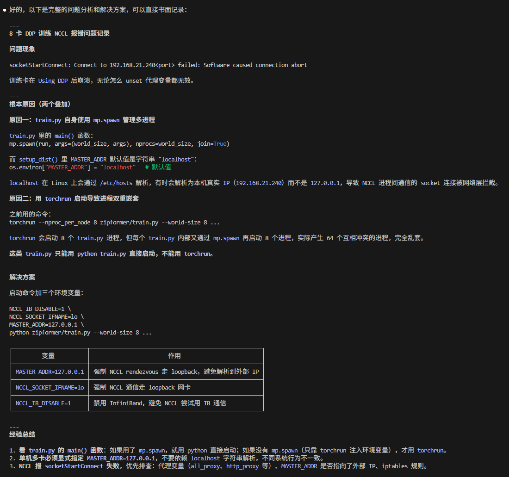

### 转化为 DLA 格式：避免 Gather 操作的优化备选方案

**方案3：Prompt 预处理（推荐）**

在 NPU 推理之前，用 CPU 计算 prompt embedding，然后作为额外输入传给 NPU。

模型输入变成 6 个：

```
输入1: audio_features [1, 166, 560]
输入2: prompt_emb_0   [1, 560]  # CPU 预计算的 embedding
输入3: prompt_emb_1   [1, 560]
输入4: prompt_emb_2   [1, 560]
输入5: prompt_emb_3   [1, 560]
输入6: dummy          [1]       # 占位符（保持接口兼容）
```

C++ 调用流程：

```cpp
// 1. CPU 端：根据 prompt 查表获取 embedding
float* prompt_emb_0 = embedding_table[language_id];   // [560]
float* prompt_emb_1 = embedding_table[event_id];      // [560]
float* prompt_emb_2 = embedding_table[event_type_id]; // [560]
float* prompt_emb_3 = embedding_table[text_norm_id];  // [560]

// 2. 输入到 NPU
NeuronRuntime_setInput(runtime, 0, audio_features, ...);
NeuronRuntime_setInput(runtime, 1, prompt_emb_0, ...);
NeuronRuntime_setInput(runtime, 2, prompt_emb_1, ...);
NeuronRuntime_setInput(runtime, 3, prompt_emb_2, ...);
NeuronRuntime_setInput(runtime, 4, prompt_emb_3, ...);
NeuronRuntime_execute(runtime);
```

**优点：**

- 只需要 1 个 DLA 文件
- 支持任意 prompt 组合
- embedding lookup 在 CPU 上做（支持 GATHER）
- NPU 只做推理计算

**缺点：**

- 需要 C++ 端实现 embedding 查表（轻量级，很快）

---

### AI 科学家面试

**1. 多模态 AI 处理**

音频：

1. ASR（语音识别）部署到端侧设备，业界有哪些可行的方案？针对语种覆盖不全（特别是小语种）怎么解决？
2. AI 语音转写需要实时处理、准确率高、延迟要求低，而端侧设备算力有限，有什么常见的优化手段和实现方案？
3. 假如要做一个 AI 语音助手（语音唤醒），利用关键词唤醒后做到屏幕内容所见即所控，有什么好的思路？

视频（图像）：

1. 实时画面帧检测，在联网状态下实时检测屏幕敏感内容，如何优化降低延迟？LLM 可以应用进来处理吗？
2. 视频超分、画质提升相关的 AI 算法有了解过吗？

文本（LLM）：

1. 目前的 LLM 在很多场景都有应用，在端侧设备要部署一个小型 LLM 来做本地会议纪要总结，这样的小型 LLM 往往降智比较厉害，针对特定任务有什么比较好的优化手段？

**2. 传统算法**

1. 隔空手势操作屏幕上的内容
2. OCR 字符识别，识别数学、化学公式等
3. 智能笔远距离划线画圈批注

---

### 关于 Skill 设计的思考

1. 除了 SenseVoice，模型类别挺多，针对 MTK 这个平台流程都是类似的，不同模型在预处理、后处理上有差异，模型结构适配是重点，由于芯片不支持动态形状需要特别处理。
2. 关于目标芯片平台，还有 RKNN 平台，流程差异比较大（主要体现在 `.pt → .onnx → .rknn`，转换工具不一样，但可以提前安装在对应的 conda 环境中），建议分开处理。
3. 希望 Skill 完全自动化整个流程（分为 Python 端和 C++ 端，分别自动化）。对于模型结构适配（如自定义 `torch_model.py`），这部分每次都需要大量调整，无法避免，因为第一步的正确性至关重要。
4. 模型结构适配以及复刻 Python 端的 C++ 代码实现，非常容易出问题，也耗时。
5. 提到的路径和工具（NDK、SDK、OnnxRuntime 等）在其他项目中都是固定的。

---

### WSL 空间压缩回收

在 Windows 中以管理员身份运行 `diskpart`，执行以下命令：

```
select vdisk file="C:\Users\HP\AppData\Local\Packages\CanonicalGroupLimited.Ubuntu22.04LTS_79rhkp1fndgsc\LocalState\ext4.vhdx"
attach vdisk readonly
compact vdisk
detach vdisk
exit
```

---

### Helsinki 两类模型预处理架构差异

| 模型类型 | tokenizer 方式 |
|----------|----------------|
| 标准模型 `opus-mt-xx-xx` | BPE + 查 `vocab.txt` |
| 大模型 `opus-mt-tc-big-xx-xx` | SentencePiece 处理 token |

---

### MTK 算法移植 Skill 设计背景

主要做 RKNN、MTK 两个平台的算法移植工作，基本步骤一致（Python 端 → C++ 端 → Android 端），细节不一样。以 MTK 为例，假设前置工作已做好（模型下载、测试数据准备、conda 环境安装测试等）：

**(1) Python 端**

- 拿到官方模型架构定义（从源码复制），进行推理测试
- 分析哪些结构 NPU 不能执行，需要拆解出来交给 CPU 处理
- 检查 NPU 芯片支持的算子，分析不支持的算子
- 修改调整原始模型架构，保存为 `xxx_model.py`
- 重新导出为 `.pt` 格式，推理测试通过后转 `.tflite`，测试通过后转 `.dla`
- 整个过程遵循一步一检查的方式

**(2) C++ 端**

- 将 Python 端推理代码转换为 C++ 推理代码
- 使用正确的 MTK NPU API 调用
- 编译成可执行文件

**(3) Android 端**

- 将可执行文件推送到 Android 设备完成推理测试

---

## Zipformer 多卡训练遇到的问题（8卡 DDP 训练 NCCL 报错）


