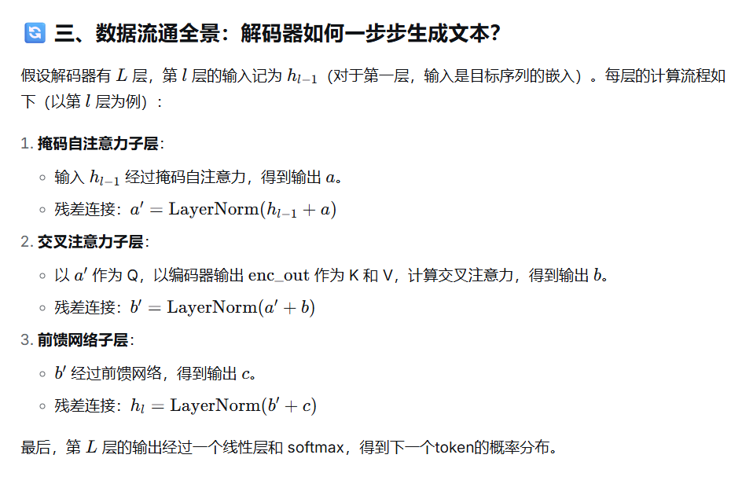
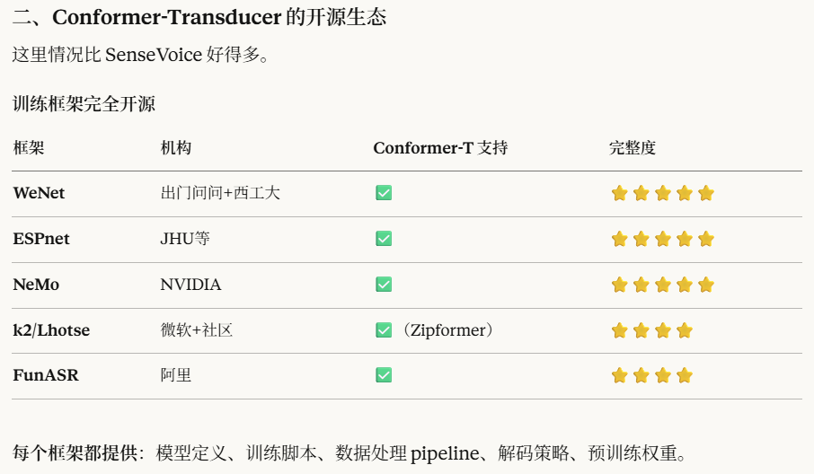
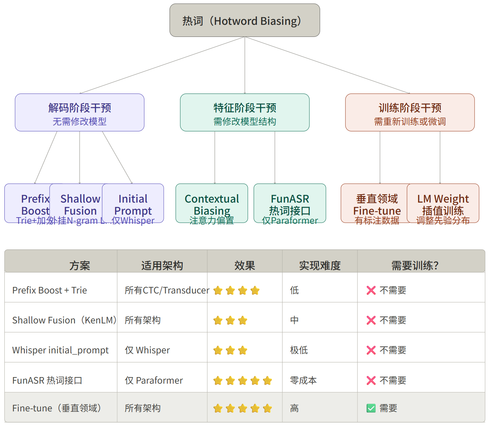
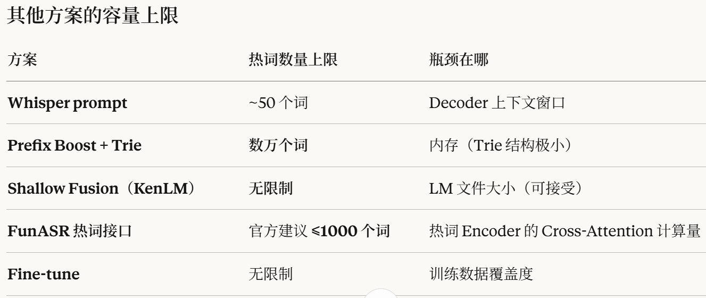
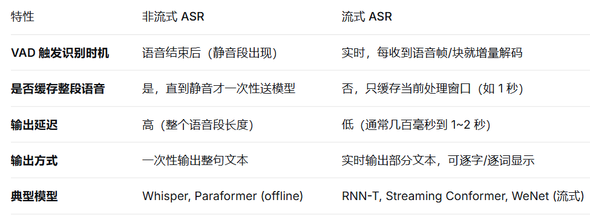
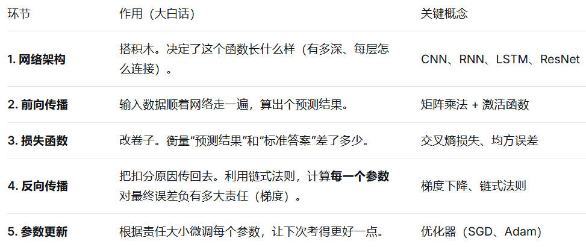

# ASR

## 一  音频特征提取

1.  原始语音信号
    
2.  预加重（可选）补偿语音信号在传输中被抑制的高频部分，让信号更加平坦
    
3.  分帧
    
4.  加窗（汉明窗） 帧/25ms  帧移10ms
    
5.  STFT 短时傅里叶变换 → 时域 → 频谱
    
6.  Mel 滤波器组 → 得到 **Mel 能量谱**
    
7.  **Mel能量谱取log→ Fbank**
    
8.  **Fbank做DCT→ MFCC**
    

**whisper（归一化 [-1,1]）senseVoice(CMVN归一化)     加速收敛，推升准确度**

## 二  核心训练目标（loss) -解码策略

**1 CTC (connectionist-temporal-classification)** 连接时序分类——>senseVoice(encoder-only)    天然支持流式 解决输入长音频帧与输出短文本无法对齐的问题，允许重复输出、输出blank 

**2 Attention—注意力机制**—>whisper(Transformer)  **Encoder**       输入：Inputs → Input Embedding（词嵌入） + Positional Encoding（位置编码）       **多头自注意力** **Multi-head attention** (带残差连接 + LayerNorm)       **前馈网络**       输出：编码器最终输出，送入解码器的交叉注意力层 **Decoder**       输入：Outputs (shifted right) → Output Embedding（输出词嵌入） + Positional Encoding（位置编码）       **掩码多头自注意力 Mask-Multi-head attention**(带残差链接 + LayerNorm)    只能看到历史token，看不到未来token  **K V cache优化**       **交叉注意力 Across Attention** (Q   K、V 来源异构)                   Q（查询）：来自解码器上一层的输出（解码器自身的特征序列），通过当前解码器层交叉注意力专属的 Wq投影得到。                    K（键）、V（值）：全部来自编码器的最终输出，通过当前解码器层交叉注意力专属的 Wk、Wv投影得到。       **前馈网络**       输出：Linear + Softmax → Output Probabilities（最终输出 token 概率分布）

 **Q K V  向量的来源？**

假设我们有一个输入序列（比如一句话中的每个词），每个词被表示为一个向量。在自注意力层中，每个词向量会通过三个不同的权重矩阵 𝑊𝑄,𝑊𝐾,𝑊𝑉 分别映射成三个向量：查询向量 𝑄、键向量 𝐾、值向量 𝑉。维度 512

**3 RNN-T（Transducer）**——>Google assistant 兼顾 CTC的简洁同时利用语言建模增强表达（声学信息和语言信息深度融合）

**Encoder**    提取声学特征

**Predictor**   建模历史输出token（浅层RNN 或者 Transform）

**Joint Network**   合并两者输出token

模型训练开源可参考资料 

**4 CTC + Attention 联合训练（Hybrid CTC/Attention）——> FunAsr/Espnet/WeNet**

CTC 提供帧级约束，Attention 提供语言建模能力

## 三  声学编码器架构

Transformer(Fbank  + 两层1D卷积  + (encoder-only))—> Multi-Head-self-attention + FNN

conformer (Fbank + 两层2D卷积  + FNN + Multi-Head-self-attention + CNN + FNN)

fast conformer

### zipformer（一个 conv-Embed 多个encoder stack —> 类似U-net结构）

1 除了第一个stack块（50HZ），其余都采用降采样，在不同帧率上学习不同分辨率的时频表征

2 注意力复用（MHSA拆分）

3 BiasNorm（代替layerNorm训练更加平滑）

4 激活函数Swoosh（代替Swish）

5  优化器ScaledAdam

paraformer

热词实现（hotword biasing）

分组 + 动态加载（最实用） 不是一次性加载所有热词，而是根据场景/对话阶段动态切换

GLCLAP热词检索(音频段和文本语义检索的方式) 类似RAG

# TTS

## 传统模式

### 一 文本前端处理

把文字变成模型能读懂的符号

### 二 声学模型

文本序列 —> 声学特征（梅尔普） 为什么不是waveForm? ① 更加光滑，好训练 ② 在低频强调细节，对语音可懂度至关重要，高频往往是干扰的噪音，需要减弱处理

Tacotron2

FastSeepch

### 三 声码器

梅尔谱 → 最终波形音频

HIFI-GAN / waveNet

## 现代端到端（VITs）

文本编码器（encoder） +  预测器（Durating Predictor） + 生成器（decoder）+  声码器（vocoder）

# VAD

## 一  核心原理

分类器，区分语音和非语音（静音、噪声、背景音） ，通过（时域  频谱 统计特性） 人声有基频周期，频谱分布集中在特定频段，短时能量和过零率有固定规律

**短时能量**：是音频信号强度的一种度量，通过计算信号在短时间窗口内的能量得到。

**过零率**：表示信号在一定时间窗口内过零点的次数。

**工作过程**

（1）实时 VAD 是连续分帧处理的，每帧（10-30ms）都送入模型判断。

（2）不是等到静音才送，而是每一帧都处理，输出当前状态，有一个缓存区来缓存结果。

（3）延迟主要来自帧长度 + 算法上下文 + hangover 后处理，通常在几十到几百毫秒。

（4）语音起始检测延迟较小（帧长度级别），语音结束检测延迟较大（因为有 hangover）。

## 二 模型架构

**GMM**（高斯混合模型）

**CNN**( 卷积层：提取局部特征——>  卷积核 参数共享   池化层：降采样——>降低计算量、防过拟合）

**TDNN**（时延神经网络）

**Silero VAD**（CNN + RNN）

# KWS

## 一  核心原理

音频特征提取（FBank）

特征处理及模型推理（输出每一个音频帧属于唤醒词的概率）

后处理与平滑（对模型输出的帧概率做时序平滑，同时判断连续的帧概率是否符合唤醒词的时序特征）

阈值判决

唤醒校验

## 二 模型架构

CNN

DTNN

Transformer/Comformer

# BERT

原始任务：1 MLM(掩码语言模型，挖坑预测token)  2 NLP(句子相识度计算)

激活函数：Gelue

双向编码器：不同于GPT这类的处理文本只能从左往右看，他是双向的

### 问题收集

1 Transform 多头注意力并行计算，怎么回事，具体了解，给个实际的例子

2 分布式多卡训练原理，DDP

3 我的模型是如何选择的，具体表现怎么样，伪流式模型是如何做到流式处理的

4 如何训练 ASR ,训练的步骤，需要注意的事项

5 whisper 编码器架构与comformer架构的差异

① 前置音频处理

whisper 两层1 D conv,第一层提取局部特征，第二层2倍时间下采样，降低计算开销

conformer 两层2 D conv，做4倍时间 — 频率双维度下采样

② encoder 架构

whisper 标准Transformer encoder架构

conformer  FFN + MTH-attention + 1D conv 卷积贯穿每一层

③ 位置编码

whisper 标准正余弦编码（全局自注意力，非流式）

conformer 相对位置编码 （局部chunk自注意力，流式）

6 设计方案以及排查问题的工程化思维

①场景层面（确地范围，定位 问题/需求）

②数据层面（数据处理  标准化、去噪/加噪、数据增强    方言、VAD截断）

③模型层面（架构选型、损失函数、模型轻量化）

④工程层面（动态参数调节、输出后处理）

7   INT8/INT4量化 的核心原理（用低比特整数数值，替代高比特浮点数值 来表示模型的权重和激活值，采用线性映射的方式）

（1）PTQ：后训练量化   精度损失优化：rotate（hadarm）

（2）QAT：量化感知训练

标准流程：FP32全精度模型准备、插入伪量化节点（权重、激活值）、量化配置（对称/非对称、量化范围）、转换为QAT模式、微调（前向INT8，反向FP32浮点，直通估计器 跳过不可导部分）、量化模型导出

核心原理：前向模拟量化 + 直通估计器绕过 round() 的零梯度，使参数能够适应量化噪声。

8  深度学习模型分布式训练的过程

**9**  训练神经网络的本质，网络架构、损失函数、激活函数、前向传播、反向传播算法、残差网络

梯度：它是一个向量，由损失函数中各个参数的偏导数排列成的向量

优化器：参数更新的策略

残差网络：信号保真，确保梯度流通更顺畅

RNN：将上一秒的状态作为下一秒的输入（存在梯度消失和梯度爆炸的问题）

LSTM：RNN基础上加入了"记忆控制器”，（遗忘门，输入门，输出门）存在参数复杂，计算量大的问题

10 采样率16HZ 上采样（48HZ）、下采样（8HZ）如何做的

11 C++ 智能指针是干嘛的，怎么用，他的原理是什么，多线程调度相关知识

12 wenet 和kaldi这个框架对比

13 langchain  langGraph 是什么，用来干什么的

核心思想：将LLM、prompts、记忆、工具调用、检索，按顺序串联，像流水线一样执行

核心能力：统一接口，组件库（提示词模板、向量数据库、工具调用、记忆管理）,Agent基础（思考、行动、观察）

### 自我介绍

1 哪里毕业的，在校期间有什么成果

2 工作经历，每段简单介绍公司是干什么的，你做了什么事情，有什么成果，你的项目有什么亮点（性能、功能）

3 技能特长（①语音算法基础—>特征提取及处理、ASR TTS  经典模型架构、解码策略 ） ②多模态算法—>（FunAudioLLM、Ultravox，LF2.5-Audio 如何训练的，推理过程是怎么样的） ③ 端侧工程化，Pytorch转Onnx、TFlite格式，轻量化，量化、剪枝、蒸馏 ，NPU适配推理

核心能力：① 知识储备、技术选型提供解决方案 ② 工程化思维，定位问题、分析问题、解决问题的能力

③ 归纳总结经验，提升个人团队工作效率

### **遇到的技术难点（调优）**

1 ASR WER 飚升漏识别排查以及VAD调优   VAD是二分类头     silero VAD 他的可调参数有哪些，代表了什么，该怎么调整     sherpa-onnx  hotword实现逻辑，greedy 还是 beam search

threshold=0.6, # 提高阈值，减少误检

min\_speech\_duration\_ms=300, # 只保留 >300ms 的语音

min\_silence\_duration\_ms=150, # 静音超150ms才切段

2 说话人识别的原理，分类不准确该怎么优化

声纹原理：1 生理特征（声道 声带  鼻腔）  2 行为特征（习惯 语速 语调）

处理流程：语音采集 → 预处理 → 语音活动检测(VAD) → 特征提取 → 说话人嵌入提取 → 相似度计算 → 判决输出（PLDA（概率线性判别分析））

ArcFace/AAM-Softmax：通过在角度空间增加一个“间隔（Margin）”，强制让同类样本更紧凑，不同类样本更分离，从而极大提升区分度

模块化：OSD(重叠检测) + SepFormer(语音分离) + ECAPA-TDNN（说话人区分）

3 端侧NPU算子适配，算子不兼容导致无法适配（算子等价替换，修改模型网络结构拆分不兼容的部分回退到CPU执行）

4 微调（Lora）后特定领域识别的WER表现良好，但是整体WER下降的比较厉害

5 模型推理延时，内存占用高怎么优化，如何平衡准确率与延时内存占用的问题
